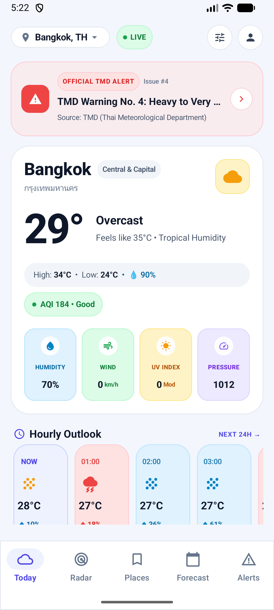
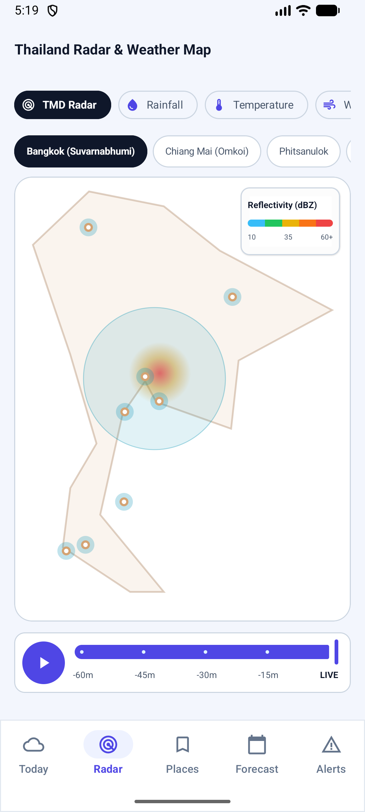
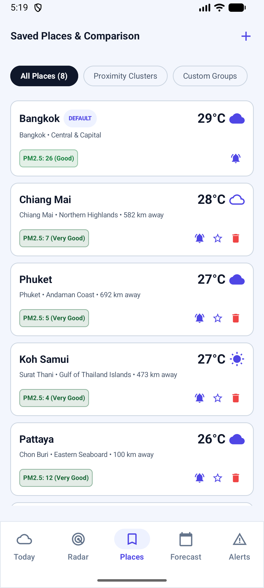
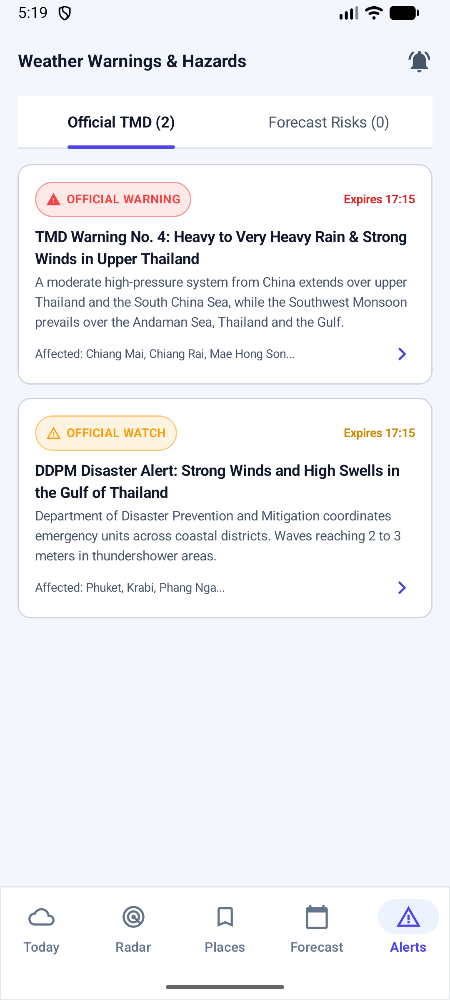
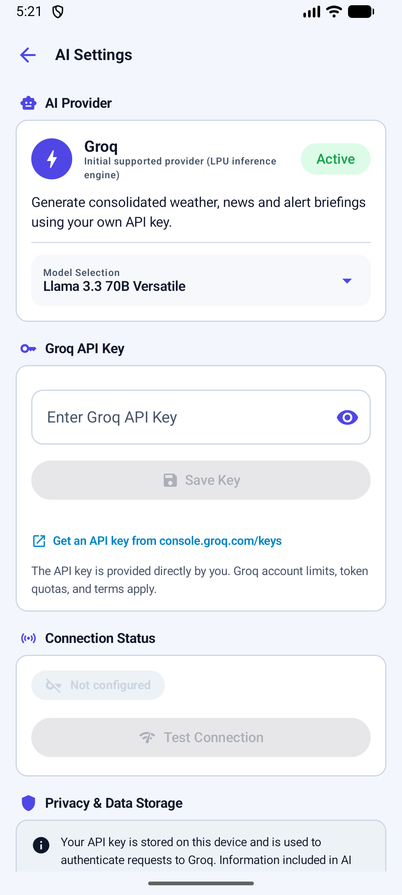
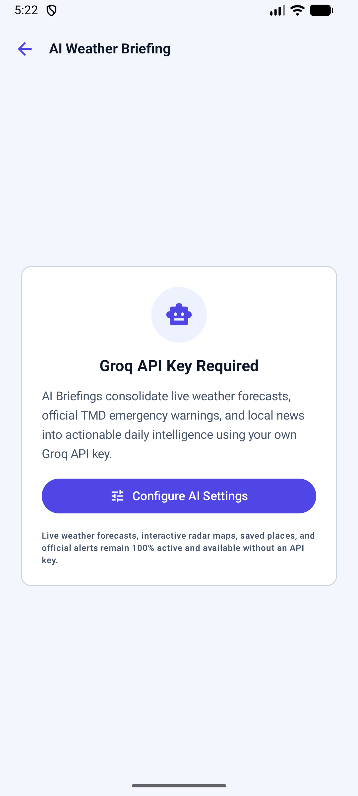

# 🇹🇭 Thailand Weather Intelligence (ไทย เวทเธอร์ อินเทลลิเจนซ์)

[](https://www.android.com/)
[](https://kotlinlang.org/)
[](https://developer.android.com/jetpack/compose)
[](https://groq.com/)
[](#nomadkit-design-system)
[](release/thailand-weather-v1.0.0.apk)
[](https://creativecommons.org/licenses/by/4.0/)

> **A production-ready, native Android application and traveler intelligence hub designed specifically for Thailand's tropical climate, monsoons, flash flooding, official government advisories, environmental air quality (PM2.5), Doppler radar sweeps, marine conditions, and lightning-fast AI meteorological briefings.**

---

## ⚡ Direct Download & Installation

Ready to use the app right now? Download the pre-built, installable APK package below:

📦 **[Download Thailand Weather Intelligence v1.0.0 APK](release/thailand-weather-v1.0.0.apk)** *(~22.5 MB)*

### How to Install on Any Android Device (Android 8.0+)
1. Download **`thailand-weather-v1.0.0.apk`** to your phone.
2. Tap the downloaded file in your browser downloads or file manager.
3. If prompted with *"For your security, your phone is not allowed to install unknown apps from this source"*, tap **Settings** and toggle **Allow from this source**.
4. Tap **Install** & open the app!
5. *(Optional for Developers)* Run via ADB:
   ```bash
   adb install -r release/thailand-weather-v1.0.0.apk
   ```

---

## 🌴 The Story: Why This App Was Born

### *Monsoon at Rage & A Vacation Already Planned*

Planning a tropical vacation to Thailand is a dream come true — turquoise waters in **Phuket** and **Krabi**, vibrant street life and night markets in **Bangkok**, island escapades in **Koh Samui**, and misty mountain temples in **Chiang Mai**.

However, nature had other plans. In recent weeks, **Thailand's weather was in total rage**:
* **Torrential Monsoon Depressions**: Relentless tropical downpours dumped record rain, triggering sudden urban flash floods along the Chao Phraya River basin in Bangkok and paralyzing traffic.
* **Treacherous Sea Swells**: Ferocious 2.5 to 3.5 meter wave swells battered the Andaman Coast and the Gulf of Thailand, forcing speedboats and passenger ferries to halt trips, and stranding tourists across popular islands.
* **Dangerous Heat Index Spikes**: Between thunderstorms, apparent feels-like temperatures skyrocketed past **42°C (108°F)**, creating dangerous conditions for heat exhaustion during outdoor sightseeing.
* **Northern Valley PM2.5 Smog**: Microscopic particulate matter and seasonal agricultural haze trapped pollutants against northern mountains, triggering respiratory warnings.

### *The Frustration: 5 Different Websites Just to Plan One Afternoon*
With flights and hotel bookings already locked in, figuring out whether it was safe to take a ferry to Phi Phi, whether a Bangkok night market would be underwater by 5:00 PM, or whether Chiang Mai air was safe for hiking required toggling endlessly between:
1. **Thai Meteorological Department (TMD)** website (often slow and with radar loops in Thai)
2. **Department of Disaster Prevention and Mitigation (DDPM)** alerts
3. **Pollution Control Department (Air4Thai/PCD)** air quality monitors
4. Generic international weather apps (which miss local microclimates and coastal swells completely)
5. Local English news outlets for flash flood and road closure bulletins

### *The Solution: Thailand Weather Intelligence*
This app was engineered to solve that exact pain: **A single, unified, location-aware Android app tailored specifically for Thailand**. It brings together official government alerts, live Doppler radar, marine surf and wave forecasts, PM2.5 sensors, 77-province proximity clustering, and an on-demand **Groq AI Meteorological Briefing** so travelers and locals always stay one step ahead of the weather.

---

## 📸 App Screenshots Gallery

*Actual native screenshots captured directly from the running Android application:*

<p align="center">
  
  
  
</p>
<p align="center">
  
  
  
</p>

| **1. Today Dashboard** | **2. Doppler Radar & Map** | **3. Places & Clustering** |
| :--- | :--- | :--- |
| Real-time observations, official TMD Alert No. 4, Feels like 35°C tropical humidity, and 24h hourly monsoon rain percentages. | Interactive vector map of Thailand with live TMD Doppler radar reflectivity loops (-60m to Live). | Haversine distance clustering (5 to 50 km) for all 77 Thai provinces and side-by-side weather comparisons. |

| **4. Two-Tier Alerts** | **5. Secure Groq AI Settings** | **6. AI Intelligence Briefing** |
| :--- | :--- | :--- |
| Strict two-tier safety architecture: Official TMD/DDPM government warnings vs app-generated forecast risks. | Android KeyStore hardware-backed AES-256-GCM encryption, masked key preview, and live ping latency test. | Real-time AI meteorological synthesis summarizing current monsoon behavior, regional alerts, and vacation advice. |

---

## 🧭 End-to-End Walkthrough of the App

The app is built around five core tabs and an intelligent AI assistant, designed to be intuitive, readable under bright sunlight, and reliable even with patchy island network connectivity.

### 1. 🏠 Today (Home Dashboard)
* **Real-Time Conditions**: Temperature, "Feels Like" apparent temperature (critical for tropical heat safety), humidity percentage, wind speed and cardinal direction.
* **Tropical Hazard Banners**: Dynamic color-coded warning banners (Torrential Downpour, Extreme Heat >40°C, Gale Winds, Hazardous PM2.5).
* **24-Hour Hourly Timeline**: Scrollable forecast showing hourly temperature, weather icons, and precipitation probability badges (e.g. 85% rain at 15:00).
* **7-Day Extended Outlook**: High/low temperature trends and expected weather patterns for weekly itinerary planning.
* **Environmental Air Quality (PCD / Air4Thai Standards)**: Live PM2.5 and PM10 concentrations with health recommendations and Thai standard color scales.
* **Coastal & Marine Conditions**: Essential for island hoppers! Wave height (in meters), swell period, sea surface temperature, and rough sea advisories (e.g., *Caution for small boats*).
* **AI Briefing Quick-Launch**: One-tap access to your daily personalized meteorological briefing.

### 2. 🛰️ Radar & Satellite (Explore)
* **Interactive Thailand Map**: Compose-native map canvas rendering Thailand's provincial boundaries, coastlines, and major islands.
* **Live TMD Doppler Radar Sweeps**: Reflectivity storm cells (green, yellow, orange, red) overlaid on the map to track storm movements in real time.
* **Doppler Loop Time Scrubber**: Scrub backwards through time (`-60m`, `-45m`, `-30m`, `-15m`, `Live`) with automatic loop playback to see where storm clouds are headed.
* **Station Status Indicators**: Real-time operational status for major TMD radar stations (Bangkok, Hua Hin, Phuket, Chiang Mai, Surat Thani).

### 3. 📍 Places & Proximity Engine
* **Unlimited Saved Locations**: Add destinations across all 77 Thai provinces, custom coordinate pins, or tourist landmarks.
* **Haversine Proximity Clustering**: Automatically groups saved locations within configurable distance radii (**5 km, 10 km, 25 km, 50 km**), perfect for travelers staying in one province but exploring multiple nearby beaches and temples.
* **Side-by-Side Comparison**: Compare temperatures, weather conditions, and rain chances across Bangkok, Phuket, Koh Samui, and Chiang Mai simultaneously.

### 4. ⚠️ Alerts & Two-Tier Safety System
To avoid confusing users, the app strictly separates data into two distinct safety tiers:
* **Tier 1: Official Government Warnings**: Legally verified Common Alerting Protocol (CAP) notices directly from the Thai Meteorological Department (TMD) and Department of Disaster Prevention and Mitigation (DDPM) covering flash floods, monsoon depressions, and tropical cyclones.
* **Tier 2: App-Generated Forecast Risks**: Smart algorithms analyze raw forecast data and warn you of emerging hazards (e.g., Dangerous Heat Index, Torrential Downpours >30mm/hr, Rough Seas >2m, Hazardous PM2.5).

### 5. 📰 Forecast & Weather News
* **Curated Incident Ingestion**: Up-to-the-minute updates on river discharge levels (Chao Phraya basin), tropical storm paths, and road conditions.
* **Automated Headline Deduplication**: Filters duplicate wire stories across major publishers (Bangkok Post, The Nation Thailand, Thai PBS World).
* **Offline Bookmarking**: Save crucial articles and advisories to read while flying or traveling in remote areas.

---

## 🤖 Steps to Include Groq API for AI Summarization

The app features an integrated AI briefing generator powered by **Groq** — the ultra-fast LPU inference platform. It converts complex raw weather telemetry, marine wave heights, air quality numbers, and active alerts into a crisp, natural language daily executive briefing.

```
┌─────────────────────────┐       ┌────────────────────────┐       ┌────────────────────────┐
│  Raw Telemetry Data     │       │  Android KeyStore      │       │  Groq Cloud Inference  │
│  - 24h Hourly Forecast  │ ────► │  AES-256-GCM Hardware  │ ────► │  LLaMA 3.3 70B         │
│  - Active TMD Warnings  │       │  Encrypted Credentials │       │  Ultra-Fast Synthesis  │
│  - Wave Swells & PM2.5  │       └────────────────────────┘       └───────────┬────────────┘
└─────────────────────────┘                                                    │
                                                                               ▼
                                                                   ┌────────────────────────┐
                                                                   │  AI Briefing Screen    │
                                                                   │  - Executive Summary   │
                                                                   │  - Regional Breakdown  │
                                                                   │  - Travel Advice Tips  │
                                                                   └────────────────────────┘
```

### Why Groq?
* **Lightning-Fast Speed**: Generates complete multi-paragraph briefings in under 1 second.
* **Generous Free Tier**: Groq provides free API keys with generous rate limits, making it completely free for personal travel and daily use.
* **State-of-the-Art Models**: Leverages Meta's latest **LLaMA 3.3 70B** and **LLaMA 3.1 8B**.

---

### Step-by-Step Setup Guide

#### 1. Get Your Free Groq API Key
1. Go to the [Groq Console](https://console.groq.com/).
2. Sign up or log in using your Google or GitHub account.
3. In the left sidebar, click on **API Keys**.
4. Click **Create API Key**.
5. Give your key a name (e.g., `Thailand Weather App`) and click **Create**.
6. Copy the generated key (it starts with `gsk_...`).

#### 2. Configure the Key in Thailand Weather Intelligence
1. Launch **Thailand Weather Intelligence** on your Android device.
2. Tap the **Settings (⚙️)** icon in the top right corner.
3. Tap **AI Settings**.
4. Paste your Groq API key into the input field.
5. Tap **Test Connection**:
   * The app sends an authenticated ping to Groq's API.
   * You will see a green **"Connected"** badge and the measured round-trip latency (e.g., *210ms*).
6. Select your preferred AI Model:
   * **`llama-3.3-70b-versatile`** *(Recommended)*: Maximum reasoning, detailed travel tips, and safety explanations.
   * **`llama-3.1-8b-instant`**: Instant responses with minimal token usage.
   * **`mixtral-8x7b-32768`**: Extended context for lengthy multi-city comparisons.

#### 3. View Your AI Meteorological Briefing
1. Navigate back to the **Today** tab.
2. Tap the **"AI Intelligence Briefing"** banner or floating sparkle icon.
3. Enjoy your instant briefing featuring:
   * **Executive Overview**: A plain-English summary of current tropical monsoon behavior.
   * **Regional Breakdown**: Specific outlooks for Bangkok, Phuket, Krabi, Koh Samui, and Chiang Mai.
   * **Practical Travel Advice**: Tailored tips (e.g. *"Carry dry bags for electronics"*, *"Avoid 15:00-18:00 ferry crossings due to 2.5m swells"*).

---

### 🔒 Enterprise-Grade Hardware Security
Your API key is safe:
* **Hardware-Backed AES-256-GCM**: Key encryption is managed by the Android KeyStore provider with hardware isolation.
* **Zero Plaintext Storage**: The raw key is never stored in SharedPreferences, SQLite, DataStore, or cache files.
* **Masked Display**: The UI only ever shows a masked snippet (e.g., `gsk_••••••••••••••••3x9Q`).
* **Backup Excluded**: Both `backup_rules.xml` and `data_extraction_rules.xml` explicitly exclude the secure credential vault from Google Drive and ADB backups.
* **Offline Resilience**: If no API key is provided or the device is offline, the app continues to operate flawlessly with standard deterministic forecasts and TMD radar.

---

## 🎨 NomadKit Design System

Thailand Weather Intelligence is styled using the **NomadKit Design System**, tailored specifically for backpackers, digital nomads, and outdoor explorers:

| Color Token | Hex Code | Role |
| :--- | :--- | :--- |
| **Primary Sand** | `#D4A373` | Main CTA buttons, active navigation indicators, key accents |
| **Secondary Ocean** | `#0891B2` | Coastal conditions, marine cards, radar sweeps, hyperlinks |
| **Tertiary Forest** | `#166534` | Safe environmental readings, verified statuses, successful pings |
| **Canvas Background** | `#FFFDF7` (Light) / `#1A1816` (Dark) | Warm, easy-on-the-eyes background preventing glare under tropical sun |
| **Card Surface** | `#FFFFFF` (Light) / `#262320` (Dark) | Clean, rounded cards with warm sand border strokes (`#E6DEC8`) |
| **Hazard Semantic Accents** | Red `#DC2626` / Amber `#CA8A04` | Distinct hazard warnings paired with icons and text (never color alone) |

---

## 📡 Verified Data Sources & Attribution

All meteorological and environmental data is sourced from verified institutions:

| Provider | Purpose | Endpoints / Assets | License / Attribution |
| :--- | :--- | :--- | :--- |
| **Open-Meteo** | Forecasting Engine, Marine Waves & AQI | `api.open-meteo.com`<br>`marine-api.open-meteo.com`<br>`air-quality-api.open-meteo.com` | **CC-BY 4.0** Open Access. In-app attribution displayed. |
| **Thai Meteorological Dept (TMD)** | Official Warnings & Doppler Radar Loops | `tmdradar.tmd.go.th`<br>`tmd.go.th/en/Weather` | Royal Thai Government Public Meteorological Service. |
| **Pollution Control Dept (Air4Thai / PCD)** | Official PM2.5 & PM10 Breakpoints | `air4thai.pcd.go.th` | Thai National Environmental Quality Standards. |
| **DDPM Thailand** | Flood & River Basin Warnings | `disaster.go.th` | Public Disaster Advisories. |
| **Groq Cloud** | High-Speed AI Synthesis | `api.groq.com/openai/v1` | Developer API Terms. User-supplied API credentials. |

---

## 🛠️ Architecture & Tech Stack

```
Thailand Weather Intelligence
├── UI Layer (Jetpack Compose + Material 3 + NomadKit)
│   ├── HomeScreen (Real-time telemetry, AirQualityCard, MarineCard)
│   ├── ExploreScreen (TMD Doppler radar loops, province canvas map)
│   ├── PlacesScreen (Haversine clustering, comparison engine)
│   ├── AlertsScreen (Two-tier official TMD vs forecast risks)
│   ├── NewsScreen (Curated incident reports & deduplication)
│   ├── AiBriefingScreen (Markdown synthesis & regional summaries)
│   └── AiSettingsScreen (Groq API key & KeyStore hardware vault)
│
├── ViewModel & State Layer (M3 Architecture)
│   ├── StateFlow reactive streams, structured coroutine scopes
│   └── Offline cache reconciliation & rate-limited notification dispatchers
│
├── Domain & Repository Layer
│   ├── WeatherRepository (OpenMeteo + TMD fallback)
│   ├── AiRepository (SecureKeyStorage + GroqClient)
│   ├── AlertsRepository (CAP parser & threshold evaluators)
│   └── PlacesRepository (Haversine distance math & grouping)
│
└── Data Layer
    ├── Room SQLite Database (Cached weather, saved places, news, alerts)
    ├── AndroidX DataStore (Language, units C/F, km/h vs mph, dark mode)
    └── Retrofit 2.11 + OkHttp 4.12 + Kotlinx Serialization
```

* **Kotlin 2.0**: Native language with modern compiler performance.
* **Jetpack Compose**: 100% declarative UI with zero legacy XML layouts.
* **Room Database 2.7.2 + KSP 2**: Robust local caching for full offline capability.
* **Android KeyStore & AES-256-GCM**: Hardware security module encryption for credentials.
* **WorkManager 2.9.1**: Battery-friendly background alert synchronizer complying with Android Doze mode.

---

## 💻 Building from Source

### Prerequisites
* **Java JDK 17 or 21**
* **Android SDK 34 - 36** (Specified via `ANDROID_HOME` or in `local.properties`)

### Build Debug APK
```bash
./gradlew assembleDebug --no-daemon
```
The compiled APK will be output to:
```
app/build/outputs/apk/debug/app-debug.apk
```

### Run Unit Tests
To run the automated test suite (including Haversine distance tests, Groq API client unit tests, KeyStore encryption tests, and alert risk evaluation tests):
```bash
./gradlew test --no-daemon
```

---

## 📦 Releases & Version History

### [v1.0.0] - Initial Production Release
* ✨ **Full Thailand Forecast Suite**: Real-time conditions, hourly timeline, 7-day forecast.
* 🌊 **Coastal & Marine Weather**: Wave heights, swells, and ferry caution advisories for Phuket, Koh Samui, Krabi, Pattaya, and Hua Hin.
* 🛰️ **Interactive Doppler Radar**: Live radar loops (-60m to Live) from TMD radar stations.
* 🤖 **Groq AI Meteorological Briefing**: Instant natural language weather summaries and vacation tips powered by LLaMA 3.3.
* 🔒 **Hardware KeyStore AES-256-GCM**: Secure API key storage.
* 📍 **Haversine Proximity Clustering**: Smart grouping for all 77 Thai provinces.
* ⚠️ **Two-Tier Safety System**: Official TMD/DDPM government warnings vs forecast risks.
* 📦 **Installable Release APK**: Added `release/thailand-weather-v1.0.0.apk`.

---

## 📄 License & Attribution

This project is licensed under the **Creative Commons Attribution 4.0 International (CC BY 4.0)**. Meteorological data attribution belongs to **Open-Meteo**, the **Thai Meteorological Department (TMD)**, and the **Pollution Control Department (PCD)**.
